<picture>
  <source media="(prefers-color-scheme: dark)" srcset="./assets/hero-dark.svg">
  <source media="(prefers-color-scheme: light)" srcset="./assets/hero-light.svg">
  
</picture>

  
  
  
  
  

## About

DevOps Engineer with 4+ years carrying the SRE and platform engineering work myself: cloud infrastructure, Kubernetes, delivery automation, observability, and incident response. At **Geniebook** I own production operations across six EKS and TKE clusters and led the multi-cloud consolidation of 30+ production services.

I connect infrastructure decisions to measurable outcomes: lower cloud spend, repeatable zero-downtime deployments, and high-signal incident response. My portfolio runs the same way, with [published SLOs and an error budget](https://faridlamaul.dev/reliability/).

| DevOps & delivery                                                                                       | Site reliability                                                                                               | Platform engineering                                                                                       |
| :------------------------------------------------------------------------------------------------------ | :------------------------------------------------------------------------------------------------------------- | :--------------------------------------------------------------------------------------------------------- |
| Standardized CI/CD, GitOps promotion, and DevSecOps gates that make releases repeatable and uneventful. | SLI/SLO-driven alerting, telemetry pipelines that hold up under burst load, and cost-aware capacity decisions. | Reusable infrastructure modules, Kubernetes runtime contracts, and golden paths teams adopt incrementally. |
| `GitLab CI/CD` `GitHub Actions` `Argo CD` `Trivy`                                                       | `SLI / SLO` `Victoria Metrics` `Grafana` `OpenSearch`                                                          | `Kubernetes` `Terraform` `Terragrunt` `Helm`                                                               |

<picture>
  <source media="(prefers-color-scheme: dark)" srcset="./assets/impact-dark.svg">
  <source media="(prefers-color-scheme: light)" srcset="./assets/impact-light.svg">
  
</picture>

## Open source

<table>
  <tr>
    <td width="50%" valign="top">
      <h3><a href="https://github.com/faridlamaul/shiptag">shiptag</a></h3>
      
Go CLI and GitHub Action that turns Conventional Commits into semantic versions, release notes, and releases on GitHub, GitLab, and Bitbucket, with a token-free dry run for review.

      
<code>Go</code> <code>Release Engineering</code> <code>GitHub Actions</code>

    </td>
    <td width="50%" valign="top">
      <h3><a href="https://github.com/faridlamaul/ci-template">ci-template</a></h3>
      
Reusable <code>workflow_call</code> GitHub Actions for semantic releases, Go / Node.js / Python CI, Go release packaging, and multi-platform Docker builds to GHCR.

      
<code>GitHub Actions</code> <code>CI/CD</code> <code>DevSecOps</code>

    </td>
  </tr>
  <tr>
    <td width="50%" valign="top">
      <h3><a href="https://github.com/faridlamaul/application-chart">application-chart</a></h3>
      
Values-driven Helm chart for APIs, workers, StatefulSets, Jobs, and CronJobs — with HPA, PDB, NetworkPolicy, ServiceMonitor, ExternalSecrets, and schema-validated values.

      
<code>Kubernetes</code> <code>Helm</code> <code>GitOps</code>

    </td>
    <td width="50%" valign="top">
      <h3><a href="https://github.com/faridlamaul/omp-cost">omp-cost</a></h3>
      
Terminal FinOps utility for AI token usage, prompt-cache efficiency, cost attribution, and forecasts across Oh My Pi profiles — with TUI, JSON, CSV, and Markdown output.

      
<code>Go</code> <code>SQLite</code> <code>Cobra</code> <code>Lipgloss</code>

    </td>
  </tr>
</table>

## How I ship

<picture>
  <source media="(prefers-color-scheme: dark)" srcset="./assets/flow-dark.svg">
  <source media="(prefers-color-scheme: light)" srcset="./assets/flow-light.svg">
  
</picture>

My portfolio is operated like a production service and released with [shiptag](https://github.com/faridlamaul/shiptag): every release is verified against production by a synthetic probe, and hourly probes feed the [SLOs and error budget](https://faridlamaul.dev/reliability/) the site publishes about itself.

## Toolbox

<picture>
  <source media="(prefers-color-scheme: dark)" srcset="https://skillicons.dev/icons?i=aws%2Cgcp%2Cazure%2Clinux%2Ckubernetes%2Cdocker%2Cterraform%2Cansible%2Cgithubactions%2Cgitlab%2Cbitbucket%2Cjenkins%2Cprometheus%2Cgrafana%2Cgo%2Cpy%2Cbash%2Cpostgres%2Cmysql%2Ckafka%2Ccloudflare%2Cgit&perline=11&theme=dark">
  <source media="(prefers-color-scheme: light)" srcset="https://skillicons.dev/icons?i=aws%2Cgcp%2Cazure%2Clinux%2Ckubernetes%2Cdocker%2Cterraform%2Cansible%2Cgithubactions%2Cgitlab%2Cbitbucket%2Cjenkins%2Cprometheus%2Cgrafana%2Cgo%2Cpy%2Cbash%2Cpostgres%2Cmysql%2Ckafka%2Ccloudflare%2Cgit&perline=11&theme=light">
  
</picture>

| Area                           | Tools                                                                                          |
| :----------------------------- | :--------------------------------------------------------------------------------------------- |
| **Cloud**                      | AWS · GCP · Azure · Tencent Cloud                                                              |
| **Containers & orchestration** | Kubernetes · Docker · Helm · Helmfile · Kustomize                                              |
| **Infrastructure as code**     | Terraform · Terragrunt · Ansible                                                               |
| **CI/CD & GitOps**             | GitLab CI/CD · GitHub Actions · Bitbucket Pipelines · Jenkins · Argo CD · Flux CD              |
| **Observability**              | Prometheus · Grafana · Victoria Metrics · Datadog · Loki · OpenSearch · OpenTelemetry · Jaeger |
| **DevSecOps**                  | Trivy · Gitleaks · SonarQube · Burp Suite · Faraday                                            |
| **Automation & languages**     | Go · Python · Bash · n8n                                                                       |
| **Data platforms**             | PostgreSQL · MySQL · Kafka · Debezium · Airflow                                                |

## GitHub activity

  <picture>
    <source media="(prefers-color-scheme: dark)" srcset="https://github-readme-stats-eight-theta.vercel.app/api?username=faridlamaul&show_icons=true&include_all_commits=true&count_private=true&hide_border=true&border_radius=16&bg_color=0b0e0c&title_color=c4f078&icon_color=c4f078&text_color=a4afa6&ring_color=c4f078">
    <source media="(prefers-color-scheme: light)" srcset="https://github-readme-stats-eight-theta.vercel.app/api?username=faridlamaul&show_icons=true&include_all_commits=true&count_private=true&hide_border=true&border_radius=16&bg_color=f5f5ef&title_color=416218&icon_color=416218&text_color=52604f&ring_color=416218">
    
  </picture>
  <picture>
    <source media="(prefers-color-scheme: dark)" srcset="https://github-readme-streak-stats.herokuapp.com/?user=faridlamaul&hide_border=true&border_radius=16&background=0b0e0c&ring=c4f078&fire=c4f078&currStreakNum=f2f4ed&sideNums=f2f4ed&currStreakLabel=c4f078&sideLabels=a4afa6&dates=929e95&stroke=263028">
    <source media="(prefers-color-scheme: light)" srcset="https://github-readme-streak-stats.herokuapp.com/?user=faridlamaul&hide_border=true&border_radius=16&background=f5f5ef&ring=416218&fire=416218&currStreakNum=1b241b&sideNums=1b241b&currStreakLabel=416218&sideLabels=52604f&dates=586853&stroke=d2d9cb">
    
  </picture>

## Let's connect

Open to **DevOps**, **Site Reliability**, and **Platform Engineering** roles, and to conversations about multi-cloud Kubernetes and delivery automation. See [faridlamaul.dev](https://faridlamaul.dev), or reach me by [email](mailto:lamaulfarid71@gmail.com) or on [LinkedIn](https://www.linkedin.com/in/faridlamaul/).
